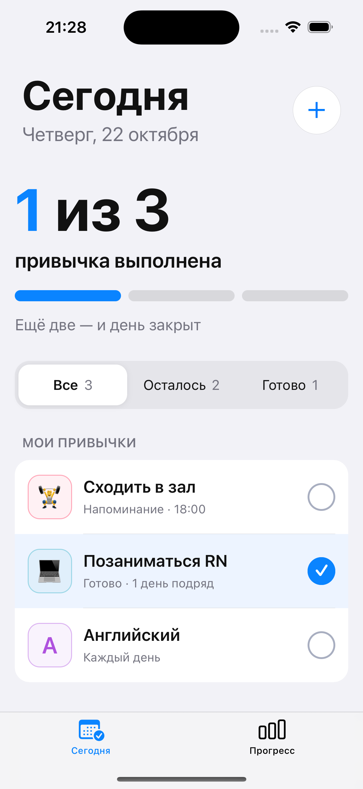
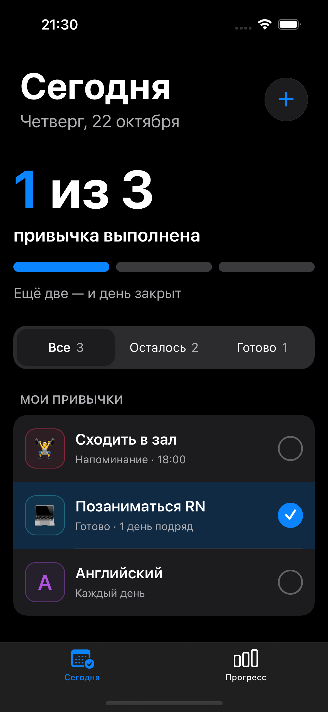
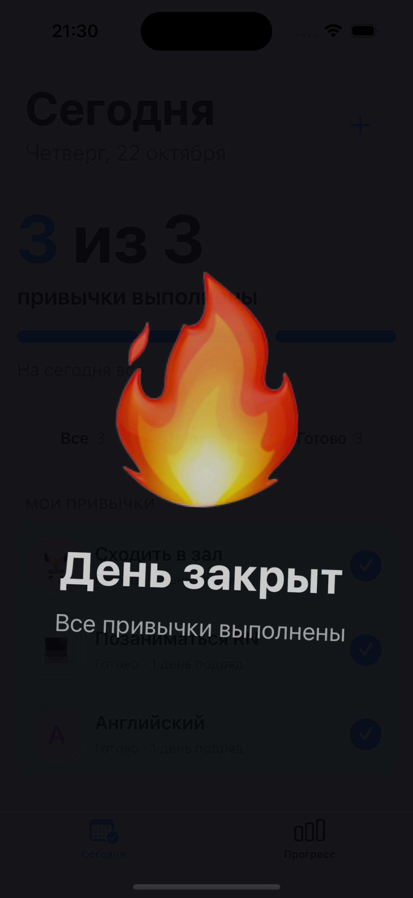
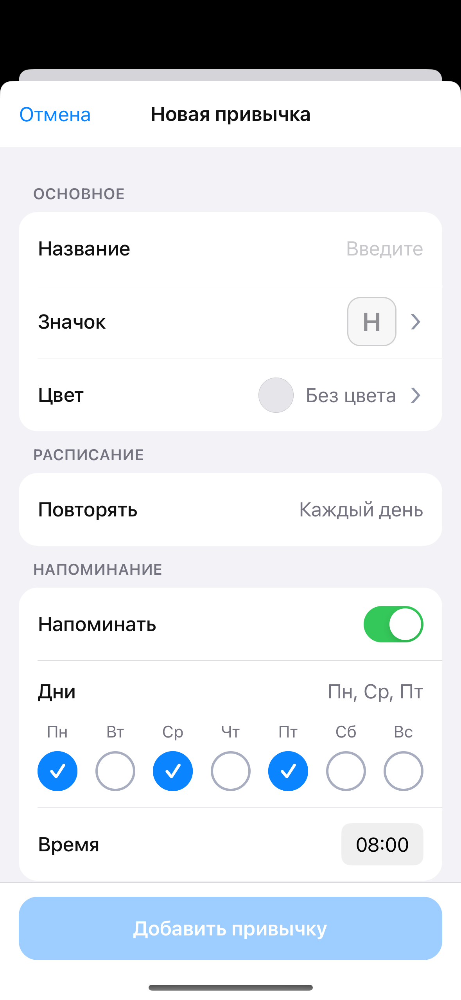
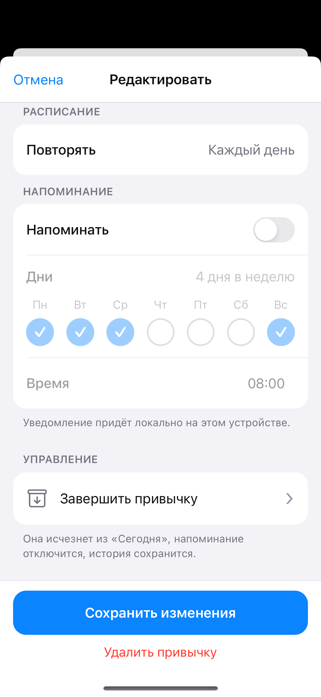
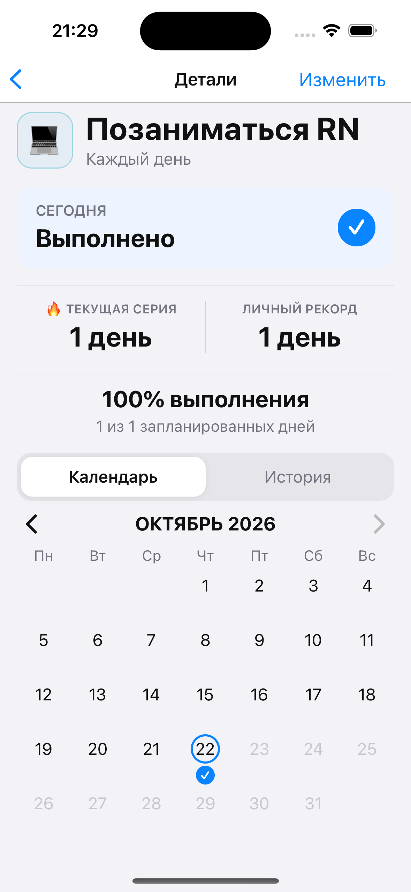
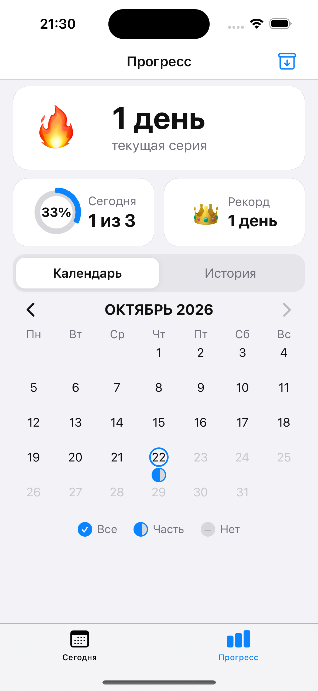
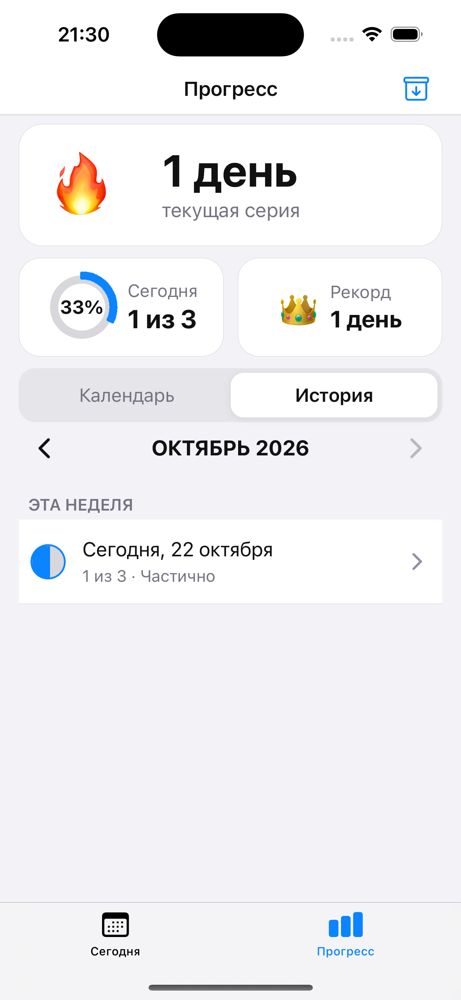
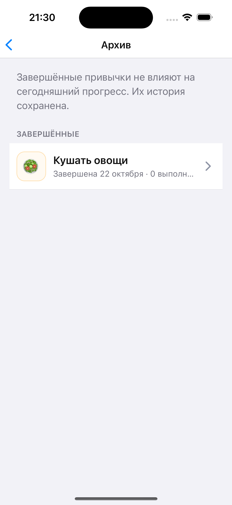

<div align="center">

# Habit Tracker

Мобильное приложение для ежедневных привычек: помогает планировать дела, отмечать выполнение и следить за прогрессом без регистрации и облачного аккаунта.

</div>

## Скриншоты

<table>
  <tr>
    <td align="center"><b>Сегодня</b><br></td>
    <td align="center"><b>Тёмная тема</b><br></td>
    <td align="center"><b>Завершение дня</b><br></td>
  </tr>
  <tr>
    <td align="center"><b>Новая привычка</b><br></td>
    <td align="center"><b>Редактирование</b><br></td>
    <td align="center"><b>Детали</b><br></td>
  </tr>
  <tr>
    <td align="center"><b>Календарь</b><br></td>
    <td align="center"><b>История</b><br></td>
    <td align="center"><b>Архив</b><br></td>
  </tr>
</table>

## Возможности

- Создание ежедневных привычек с названием, эмодзи и цветом.
- Отметка выполнения прямо на экране «Сегодня».
- Фильтры всех, оставшихся и выполненных привычек.
- Локальные напоминания в выбранные дни и время.
- Текущая серия, личный рекорд и процент выполнения.
- Общий календарь прогресса и история по дням.
- Подробная статистика и календарь для каждой привычки.
- Редактирование, завершение, восстановление и удаление привычек.
- Анимация и тактильный отклик после выполнения всех дел на день.
- Светлая и тёмная темы.
- Локальное хранение данных на устройстве.

## Запуск

### Требования

- Node.js 24 и npm 11
- macOS и Xcode для запуска iOS
- Ruby и Bundler для установки CocoaPods-зависимостей
- Android Studio, Android SDK с настроенной переменной `ANDROID_HOME` и JDK 17 для запуска Android
- iOS Simulator или созданный в Android Studio виртуальный Android-девайс (AVD)

Клонируйте проект и установите зависимости:

```bash
git clone https://github.com/londxz/habit-tracker-mobile.git
cd habit-tracker-mobile
nvm install 24
nvm use 24
npm ci
```

Команды `nvm install` и `nvm use` можно пропустить, если Node.js 24 уже установлен другим способом.

### iOS

Доступно только на macOS. Если команда `bundle` ещё не установлена:

```bash
gem install bundler
```

Установите Ruby- и CocoaPods-зависимости, затем запустите приложение:

```bash
bundle install
bundle exec pod install --project-directory=ios
npm run ios
```

### Android

1. Откройте Android Studio → **Tools → Device Manager**.
2. Создайте виртуальное устройство, если его ещё нет.
3. Посмотрите имена установленных AVD:

```bash
$ANDROID_HOME/emulator/emulator -list-avds
```

4. Запустите нужный эмулятор, подставив имя из предыдущей команды:

```bash
$ANDROID_HOME/emulator/emulator -avd YOUR_AVD_NAME
```

5. После полной загрузки эмулятора откройте второй терминал в корне проекта и запустите приложение:

```bash
npm run android
```

React Native CLI автоматически запустит Metro. Если Metro уже работает, будет использован текущий процесс на порту `8081`.

## Технологии

- React Native 0.88, React 19 и TypeScript 6
- React Navigation: native stack и native bottom tabs
- MMKV для локального хранения данных
- Notifee для локальных уведомлений
- React Native Haptic Feedback для тактильного отклика
- React Native Vector Icons / Ionicons
- Liquid Glass с безопасным fallback для неподдерживаемых платформ
- CocoaPods и Gradle для нативных сборок
